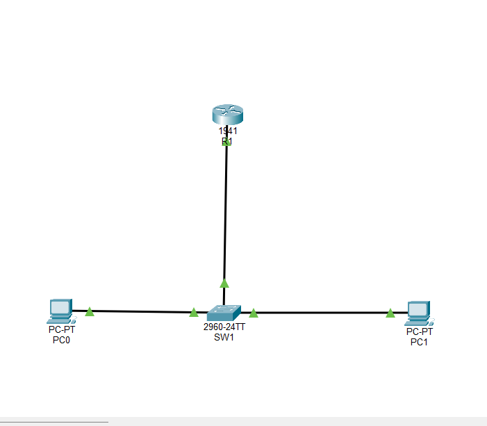

# Small Office Network Security Blueprint

## 1. Introduction
This project focuses on designing and securing a hypothetical small office network using Cisco Packet Tracer. The main purpose is to understand how a small office network operates and how basic security measures can help protect network devices and internal resources.

The network consists of a Cisco 1941 router, a Cisco 2960 switch, and two end devices representing different departments. The network is divided into two VLANs: VLAN 10 (ADMIN) and VLAN 20 (EMPLOYEES), allowing logical network segmentation.

Router-on-a-stick configuration is used for inter-VLAN routing, while Access Control Lists (ACLs) are configured to restrict traffic between the two departments. Additional security measures include switch port security, disabling unused switch ports, and enabling SSH version 2 for secure remote device management.

The project is implemented and tested in a simulated environment using Cisco Packet Tracer. It demonstrates practical networking concepts, basic security configurations, and the importance of documenting and verifying network security controls.

## 2. Project Objectives
The main objectives of this project are:

1. To understand the basic structure and working of a small office network.
2. To identify the functions of routers, switches, and end devices.
3. To create an IP addressing plan for different network segments.
4. To implement VLAN-based network segmentation for ADMIN and EMPLOYEES.
5. To configure inter-VLAN routing using the router-on-a-stick method.
6. To implement Access Control Lists (ACLs) to control traffic between VLANs.
7. To improve network security using switch port security and unused-port shutdown.
8. To enable secure remote device management using SSH version 2.
9. To test network connectivity and verify the implemented security controls.
10. To document potential security risks, limitations, and recommendations.
    
## 3. Network Design
The small office network is designed using a Cisco 1941 router, a Cisco 2960 switch, and two end devices. The devices are connected using copper straight-through cables.

The router is connected to the switch through GigabitEthernet0/0 on the router and GigabitEthernet0/1 on the switch. The switch-to-router connection is configured as an 802.1Q trunk to carry traffic from multiple VLANs.

The two end devices are connected to separate access ports on the switch:

- PC0 is connected to FastEthernet0/1 and assigned to VLAN 10 (ADMIN).
- PC1 is connected to FastEthernet0/2 and assigned to VLAN 20 (EMPLOYEES).

### Logical Network Segmentation

The network is divided into two VLANs:

- VLAN 10 (ADMIN): Uses the subnet 192.168.10.0/24.
- VLAN 20 (EMPLOYEES): Uses the subnet 192.168.20.0/24.

### Inter-VLAN Routing

Router-on-a-stick is implemented on router R1 using two logical subinterfaces:

- GigabitEthernet0/0.10 handles VLAN 10 traffic.
- GigabitEthernet0/0.20 handles VLAN 20 traffic.

Each subinterface is assigned the corresponding VLAN gateway IP address. This allows communication between the VLANs, subject to the configured Access Control List.

### Network Topology Diagram

The network topology diagram illustrates the physical connections between the router, switch, and end devices, along with the two logical network segments.

## 4. Device Inventory
The network consists of four devices: one router, one managed switch, and two end devices. Each device has a specific role in providing network connectivity, segmentation, and administration.

### 1. Router R1

- Model: Cisco 1941
- Role: Main network router.
- Interface connected to switch: GigabitEthernet0/0.
- Subinterfaces: GigabitEthernet0/0.10 and GigabitEthernet0/0.20.
- Responsibilities:
  - Provides inter-VLAN routing.
  - Acts as the default gateway for both VLANs.
  - Applies ACL-based traffic restrictions.
  - Supports secure remote management through SSH version 2.

### 2. Switch SW1

- Model: Cisco 2960.
- Role: Central network switch.
- Uplink: GigabitEthernet0/1.
- Connected end devices: PC0 and PC1.
- Responsibilities:
  - Provides VLAN-based network segmentation.
  - Connects the router and end devices.
  - Implements switch port security.
  - Disables unused switch ports.
  - Provides SSH-based remote management.

### 3. PC0 — ADMIN Workstation

- Device type: Packet Tracer PC.
- Connected interface: FastEthernet0/1 on SW1.
- VLAN: 10 (ADMIN).
- IP address: 192.168.10.10.
- Default gateway: 192.168.10.1.
- Purpose: Represents an administrative workstation.

### 4. PC1 — EMPLOYEES Workstation

- Device type: Packet Tracer PC.
- Connected interface: FastEthernet0/2 on SW1.
- VLAN: 20 (EMPLOYEES).
- IP address: 192.168.20.10.
- Default gateway: 192.168.20.1.
- Purpose: Represents an employee workstation.

## 5. IP Addressing Plan

## 6. Security Implementation

## 7. Testing and Verification

## 8. Security Risk Assessment

## 9. Security Recommendations

## 10. Project Limitations

## 11. Conclusion
