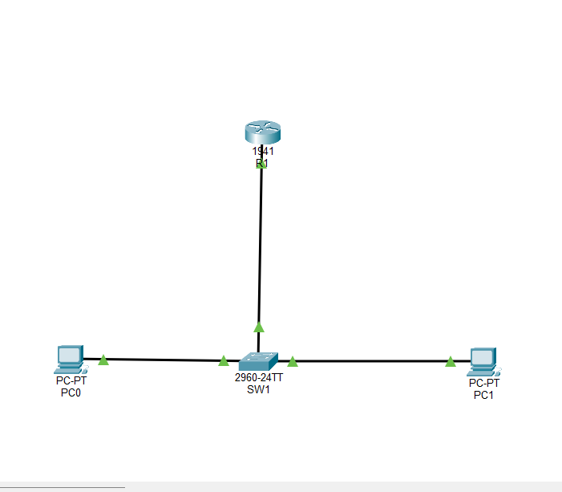

# Small Office Network Security Blueprint

## Project Overview
This project focuses on designing and securing a hypothetical small office network. The goal is to understand basic networking concepts, identify common security risks, and recommend appropriate security controls.

## Objectives
- Understand how a small office network is structured.
- Identify common networking devices and their functions.
- Develop an IP addressing plan.
- Understand network segmentation and access control.
- Identify potential cybersecurity risks.
- Recommend security measures to improve network protection.

## Tools & Technologies

- Cisco Packet Tracer
- Cisco IOS CLI
- GitHub
- Windows

## Device Inventory

| Device Name | Device Type | Model | Purpose |
|---|---|---|---|
| R1 | Router | Cisco 1941 | Inter-VLAN routing, traffic control and SSH management |
| SW1 | Switch | Cisco 2960 | VLAN segmentation, port security and device connectivity |
| PC0 | End Device | PC | ADMIN network workstation |
| PC1 | End Device | PC | EMPLOYEES network workstation |
## IP Addressing Plan

| Device | Interface | IP Address | Subnet Mask | Default Gateway | VLAN |
|---|---|---|---|---|---|
| R1 | G0/0.10 | 192.168.10.1 | 255.255.255.0 | N/A | 10 - ADMIN |
| R1 | G0/0.20 | 192.168.20.1 | 255.255.255.0 | N/A | 20 - EMPLOYEES |
| SW1 | VLAN 10 | 192.168.10.2 | 255.255.255.0 | 192.168.10.1 | 10 - ADMIN |
| PC0 | FastEthernet0 | 192.168.10.10 | 255.255.255.0 | 192.168.10.1 | 10 - ADMIN |
| PC1 | FastEthernet0 | 192.168.20.10 | 255.255.255.0 | 192.168.20.1 | 20 - EMPLOYEES |

## Security Risk Assessment

| Potential Risk | Impact | Security Control |
|---|---|---|
| Unauthorized device connection | Unauthorized network access | Switch port security with sticky MAC |
| Unauthorized access to ADMIN network | Exposure of administrative resources | VLAN segmentation and extended ACL |
| Access through unused switch ports | Unapproved network connections | Unused ports administratively disabled |
| Insecure remote device management | Unauthorized device administration | SSH version 2 and local authentication |
| Unauthorized router SSH access | Router configuration exposure | SSH-ADMIN-ONLY access control list |

### Network Addressing Details

- ADMIN subnet: 192.168.10.0/24
- EMPLOYEES subnet: 192.168.20.0/24
- Subnet mask: 255.255.255.0
- Inter-VLAN routing: Router-on-a-stick using R1

## Planned Project Scope

The intended office environment includes:
- Employee computers
- Management workstation
- Network printer
- Internal server
- Router and network switch
- Employee and guest network concepts

## Planned Deliverables
- [x] Network topology diagram
- [ ] Device inventory
- [ ] IP addressing plan
- [x] Network segmentation design
- [ ] Security risk assessment
- [ ] Security recommendations
- [x] Cisco Packet Tracer simulation
- [ ] Final project report

## Learning Outcomes
Through this project, I aim to develop practical knowledge of computer networking, network security, risk assessment, and technical documentation.

## Project Status
Milestones 1–4 completed. Additional project documentation and security testing are in progress.

## Disclaimer
This project is designed for educational purposes using a hypothetical office environment. No unauthorized networks or systems will be accessed or tested.
## Network Design and Security Features

The current network is divided into two VLANs:

- **VLAN 10 — ADMIN:** Dedicated administrative network.
- **VLAN 20 — EMPLOYEES:** Separate employee network.

Security features implemented:

- VLAN-based network segmentation.
- Inter-VLAN routing using router-on-a-stick.
- Extended ACL to restrict employee-to-admin traffic.
- Switch port security with sticky MAC learning.
- Shutdown of unused switch ports.
- SSH version 2 for secure device management.
- Restricted router SSH access using an ACL.
 ## Network Topology

---
## Project Progress

### Milestone 1: Network Setup and VLAN Segmentation

- Created a small office network using a Cisco 1941 router and Cisco 2960 switch.
- Connected two PCs to separate VLANs.
- Created VLAN 10 (ADMIN) and VLAN 20 (EMPLOYEES).
- Configured an 802.1Q trunk between the switch and router.
- Configured router-on-a-stick for inter-VLAN routing.

### Milestone 2: ACL-Based Traffic Control

- Created an extended ACL named `EMPLOYEE-RESTRICTION`.
- Applied the ACL inbound on router subinterface `GigabitEthernet0/0.20`.
- Blocked IP traffic initiated from EMPLOYEES to ADMIN.
- Allowed ICMP echo replies from EMPLOYEES to ADMIN so ADMIN-initiated ping tests could succeed.

### Milestone 2 Verification Results

| Test | Expected result | Actual result |
|---|---|---|
| PC0 → ADMIN gateway | Success | Passed |
| PC1 → EMPLOYEES gateway | Success | Passed |
| PC0 → PC1 before ACL | Success | Passed |
| PC1 → PC0 after ACL | Blocked | Passed |
| PC0 → PC1 after ACL | Success | Passed |

### Milestone 3: Network Hardening

- Configured switch port security on `Fa0/1` and `Fa0/2`.
- Set a maximum of one secure MAC address per access port.
- Enabled sticky MAC address learning.
- Configured violation mode as `restrict` to drop traffic from unauthorized MAC addresses while keeping the port active.
- Verified that both PC MAC addresses were learned as secure sticky addresses.
- Administratively disabled unused switch ports (`Fa0/3–Fa0/24` and `Gig0/2`).
- Kept active PC connections and the router uplink operational.

### Milestone 3 Verification Results

| Test | Expected result | Actual result |
|---|---|---|
| Port security on Fa0/1 and Fa0/2 | Enabled | Passed |
| Sticky MAC learning | One MAC per port | Passed |
| Unused FastEthernet ports | Disabled | Passed |
| Unused GigabitEthernet0/2 | Disabled | Passed |
| Active PC and router ports | Remain operational | Passed |
| PC0 → ADMIN gateway | Success | Passed |
| PC1 → EMPLOYEES gateway | Success | Passed |
| PC0 → PC1 | Success | Passed |

### Milestone 3: Additional Security Notes

- Port security helps limit unauthorized device connections to access ports.
- Sticky MAC learning dynamically learns and stores secure MAC addresses.
- Restrict mode drops traffic from violating MAC addresses and records security violations.
- Unused switch ports are administratively disabled to reduce unnecessary access points.
 
### Security Notes

- VLANs provide logical network segmentation.
- Extended ACLs control traffic based on source and destination IP addresses and protocol.
- This is a basic stateless ACL demonstration, not a stateful firewall.
- Further security controls and testing are required before treating this as a production-ready network.
### Milestone 4: Secure Device Management

- Configured privileged EXEC password protection on the router.
- Created a local administrator account.
- Configured SSH version 2 for secure remote management.
- Disabled Telnet access on router VTY lines.
- Restricted router SSH management access to the ADMIN subnet using a standard ACL.
- Applied similar SSH-based management security to the switch.
- Verified remote SSH login to both SW1 and R1.
- Saved router and switch configurations.

### Milestone 4 Verification Results

| Test | Expected result | Actual result |
|---|---|---|
| Router SSH from ADMIN | Allowed | Passed |
| Switch SSH from ADMIN | Allowed | Passed |
| SSH management restriction | ADMIN subnet only | Configured |
| SSH version | Version 2 | Passed |
| Router configuration saved | Successful | Passed |
| ADMIN → EMPLOYEES | Allowed | Passed |
| EMPLOYEES → ADMIN | Blocked | Passed |

## Project Limitations

- This is a simulated small-office network built in Cisco Packet Tracer.
- The extended ACL is stateless and does not provide full stateful firewall inspection.
- RSA 1024-bit keys were used for Packet Tracer compatibility; stronger keys should be used in production.
- This project demonstrates foundational network security concepts and is not a production-ready security deployment.

### Milestone 4: Additional Security Notes

- SSH provides encrypted remote device management.
- Local user authentication avoids relying on a shared VTY password.
- The SSH management ACL limits remote access to the ADMIN subnet.
- RSA 1024-bit keys were used for Packet Tracer compatibility; production systems should use stronger supported key sizes.
- This project demonstrates basic network segmentation and access control, not a complete production security architecture.

**Author:** Samruddha Kale  
**Field:** IT & Cybersecurity
